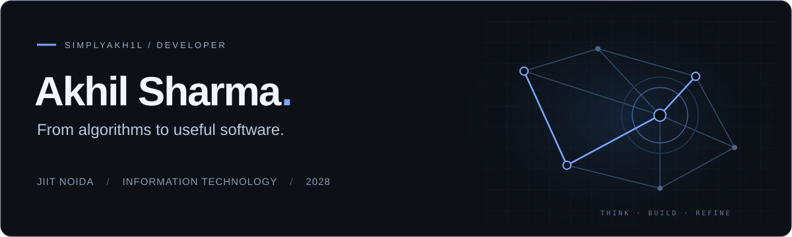
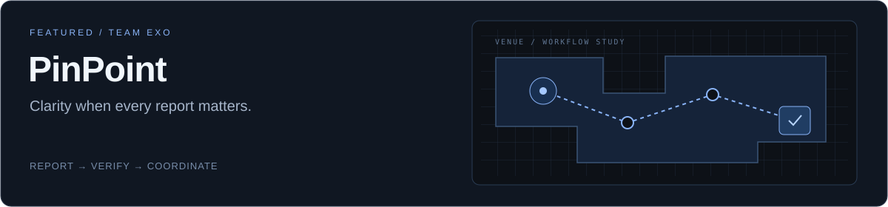
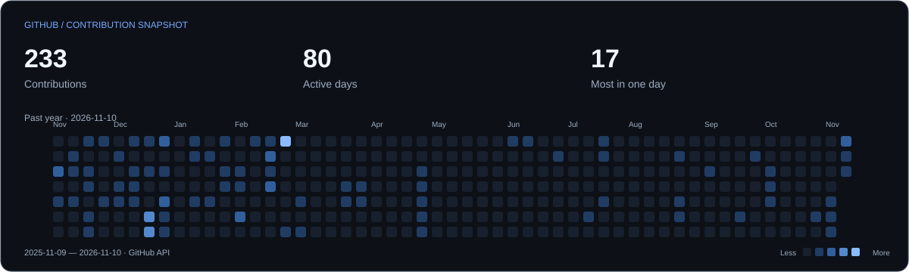

<picture>
  <source media="(max-width: 600px)" srcset="./assets/hero-mobile.svg">
  
</picture>

  <a href="#selected-work">Selected work</a> &nbsp; / &nbsp;
  <a href="#toolkit">Toolkit</a> &nbsp; / &nbsp;
  <a href="#competitive-programming">Competitive programming</a> &nbsp; / &nbsp;
  <a href="#github-activity">Activity</a> &nbsp; / &nbsp;
  <a href="#connect">Connect</a>

## A little context

I'm **Akhil**, an Information Technology undergraduate at **JIIT Noida** (B.Tech, **2028**), with a **9.16 CGPA**. My work spans real-time web applications, database projects, and algorithmic problem solving.

I enjoy the part where a difficult problem becomes a clear, usable system: a map that updates as reports arrive, a workflow with explicit permissions, or an algorithm that makes the constraints click.

## Selected work

### DockPlan

**3D cargo packing that considers every delivery stop.**

A custom deterministic extreme-point heuristic places cargo inside a van while enforcing collision, door-clearance, payload, support, stacking and unloading constraints. An interactive Three.js viewer uses the actual computed coordinates, with server-validated unloading simulation and CSV workflows. Google account support keeps saved plans and vehicles private; hosted sign-in activation requires OAuth/database configuration.

React · JavaScript · Three.js · Express · MongoDB

[Explore the repository ↗](https://github.com/simplyakh1l/DockPlan) · [Packing algorithm](https://github.com/simplyakh1l/DockPlan/blob/main/docs/ALGORITHM.md)

### Seller360

**A voice-first workspace for seller account reviews.**

Review disclosed sample seller performance, discuss evidence with Nova, and track approved next steps. Deterministic analytics stay separate from model reasoning; the app has no live marketplace connection and performs no marketplace transactions.

React · TypeScript · Express · Gemini · Netlify

[Open Seller360 ↗](https://seller360-akhil.netlify.app) · [Explore the repository](https://github.com/simplyakh1l/Seller360)

### PinPoint

**A shared operational picture for live events.**

Attendees report incidents on a venue map. Staff verify reports, coordinate responders, and approve route guidance in an event-specific command center. Reactive Convex subscriptions keep connected clients in sync.

- **Event-aware access:** Google sign-in, separate attendee/staff join codes, and server-side membership checks.
- **Explicit response workflow:** report intake, verification, crowd-risk assessment, routing proposals, and responder task tracking. Staff retain route approval.
- **Optional AI layer:** structured report enrichment and approved-source Q&A, separate from the core workflow and off by default.

React · TypeScript · Convex · Tailwind CSS · Vite

[Explore the repository ↗](https://github.com/simplyakh1l/PinPoint) · [Architecture & implementation](https://github.com/simplyakh1l/PinPoint#architecture-and-implementation-notes)

Team EXO project.

## Toolkit

Technologies present in my repositories, grouped by where I use them.

| Focus | Technologies |
| :--- | :--- |
| **Interfaces** |  &nbsp; React &nbsp;  &nbsp; TypeScript &nbsp;  &nbsp; Tailwind CSS |
| **Data & backend** |  &nbsp; Python &nbsp;  &nbsp; MySQL &nbsp; **◇** Convex |
| **Problem solving & build** |  &nbsp; C++ &nbsp;  &nbsp; Vite |

## Competitive programming

**1,500+ problems solved** across DSA and competitive programming. 
**Codeforces Specialist** · Peak rating **1464** · [LeetCode ↗](https://leetcode.com/u/simply_akh1l/)

| Year | Competition | Result |
| :--- | :--- | :--- |
| 2026 | Flipkart GRiD | **Semi-Finalist** |
| 2026 | Knuth Cup | **Winner** |
| 2026 | Code Clash | **Winner** |
| 2026 | Code in the Dark | **First Runner-Up** |

## GitHub activity

<a href="https://github.com/simplyakh1l?tab=overview">
<picture>
  <source media="(max-width: 600px)" srcset="./assets/activity-mobile.svg">
  
</picture>
</a>

A dated snapshot of GitHub's contribution calendar, refreshed weekly. Contributions follow GitHub's counting rules; this is not a count of commits or problems solved. If the image is unavailable, [view the live contribution calendar](https://github.com/simplyakh1l?tab=overview).

## Connect

[LinkedIn ↗](https://www.linkedin.com/in/simply-akh1l/) &nbsp; / &nbsp; [LeetCode ↗](https://leetcode.com/u/simply_akh1l/) &nbsp; / &nbsp; [Email ↗](mailto:akhilsharma22092006@gmail.com)

For project conversations, you can also [explore my repositories](https://github.com/simplyakh1l?tab=repositories).

---

Built with intention. Kept simple.
